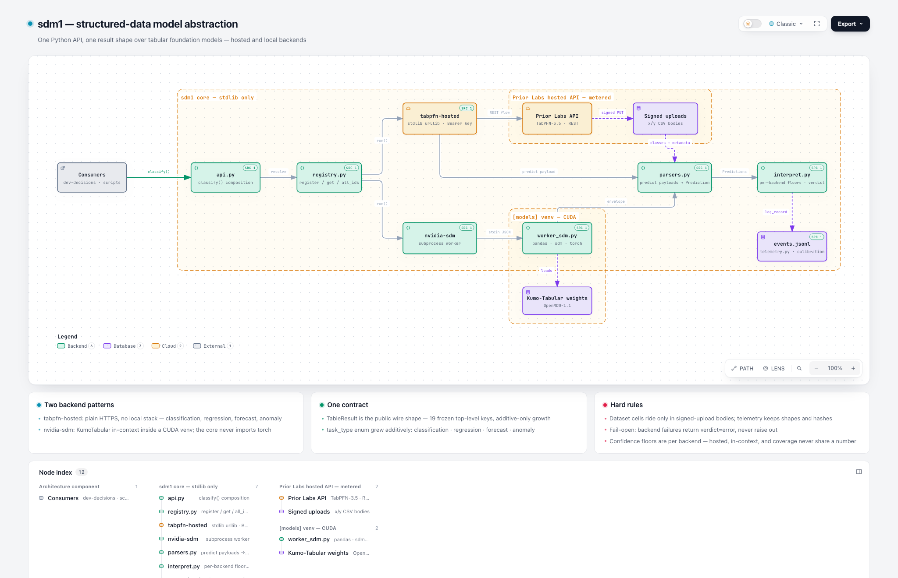

# sdm1

> Structured-data model abstraction: NVIDIA SDM (Kumo-Tabular), Prior Labs TabPFN (hosted), and other tabular/relational foundation models — one Python API, one result shape, normalized telemetry.

**Status: v0.1.0 + hosted lane live.** The v0.1.0 foundation (types, registry, telemetry, nvidia-sdm backend) shipped 2026-09-29; the `tabpfn-hosted` provider (Prior Labs REST API — classification/regression/forecast/anomaly, no local stack) shipped 2026-10-07. Set `TABPFN_API_KEY` and classify from any machine; the CUDA path stays behind the `[models]` extra for the local backend.

- Developer reference — [TECHNICAL-DOCUMENTATION.md](TECHNICAL-DOCUMENTATION.md)
- Architecture — [](docs/architecture/system.html) (interactive HTML + candidate source in `docs/architecture/`)
- Behavior contract — [FUNCTIONAL-SPECIFICATIONS.md](FUNCTIONAL-SPECIFICATIONS.md)
- Architecture — [docs/architecture/overview.md](docs/architecture/overview.md)
- Upstream inspiration — [NVIDIA/structured-data-models](https://github.com/NVIDIA/structured-data-models) (GPU-native foundation models, tensor subclasses, and processors for structured data)

## Development

```bash
python3 -m venv .venv
.venv/bin/pip install -e '.[dev]'
.venv/bin/python -m pytest -q
.venv/bin/ruff check .
```

The core is stdlib-only (`dependencies = []`); the torch/NVIDIA-SDM backend stack arrives later behind the `[models]` extra in an isolated venv.
